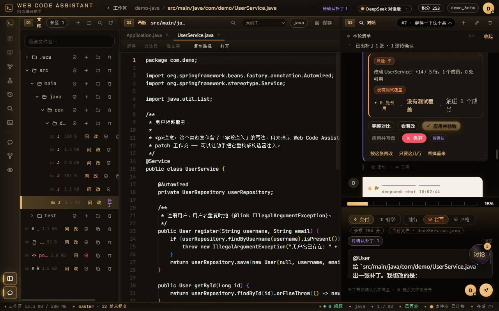
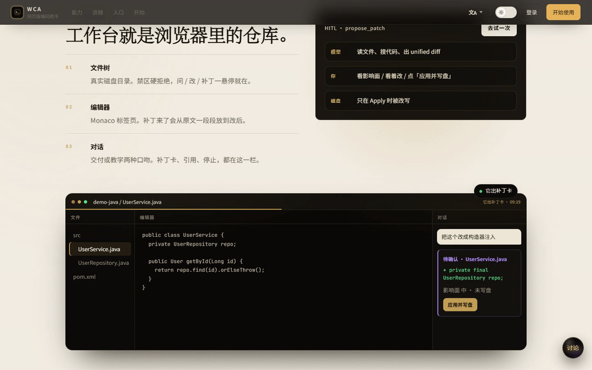
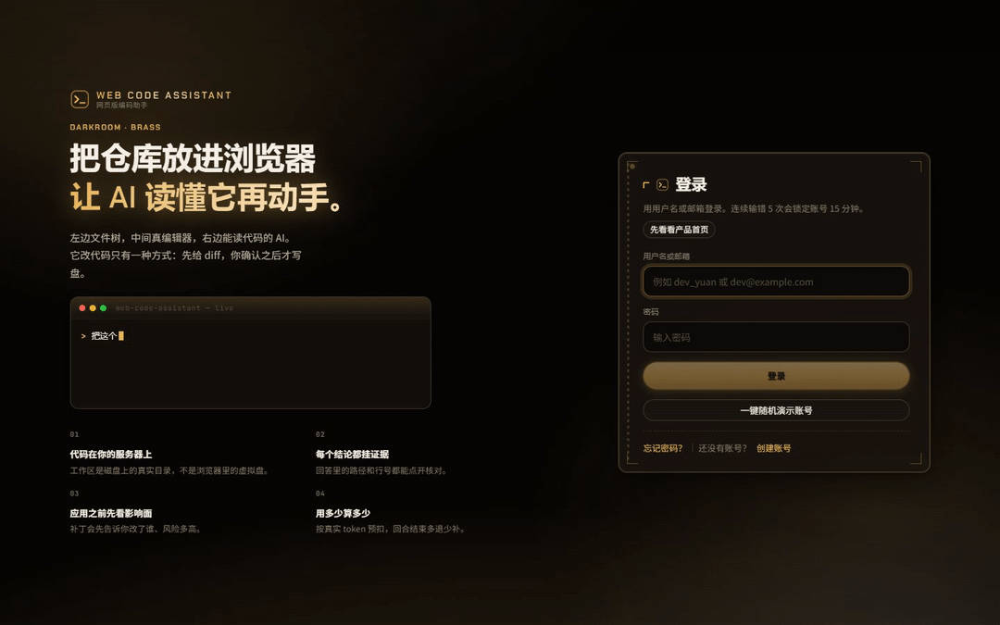
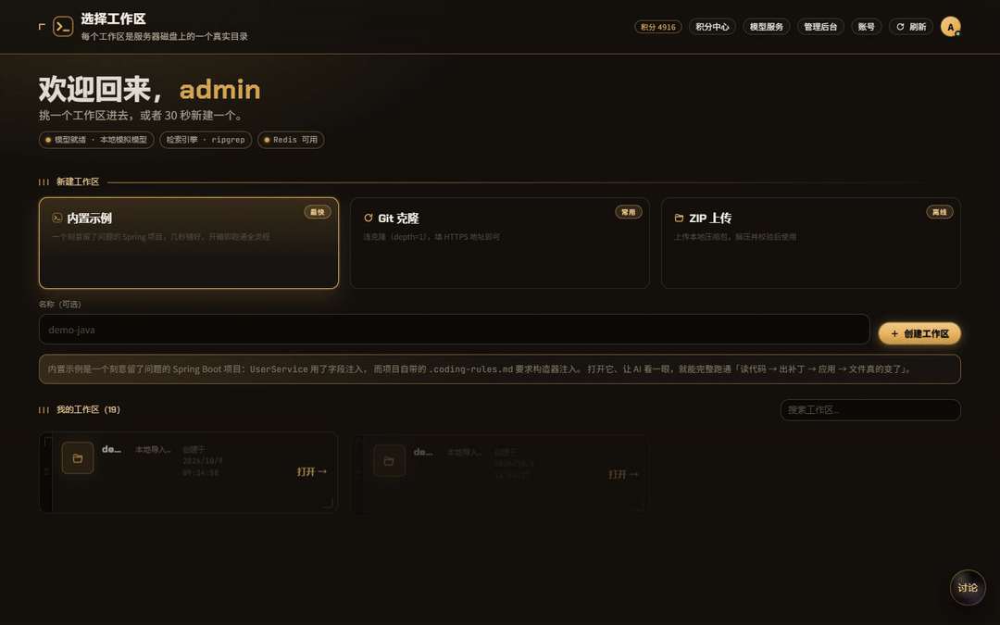
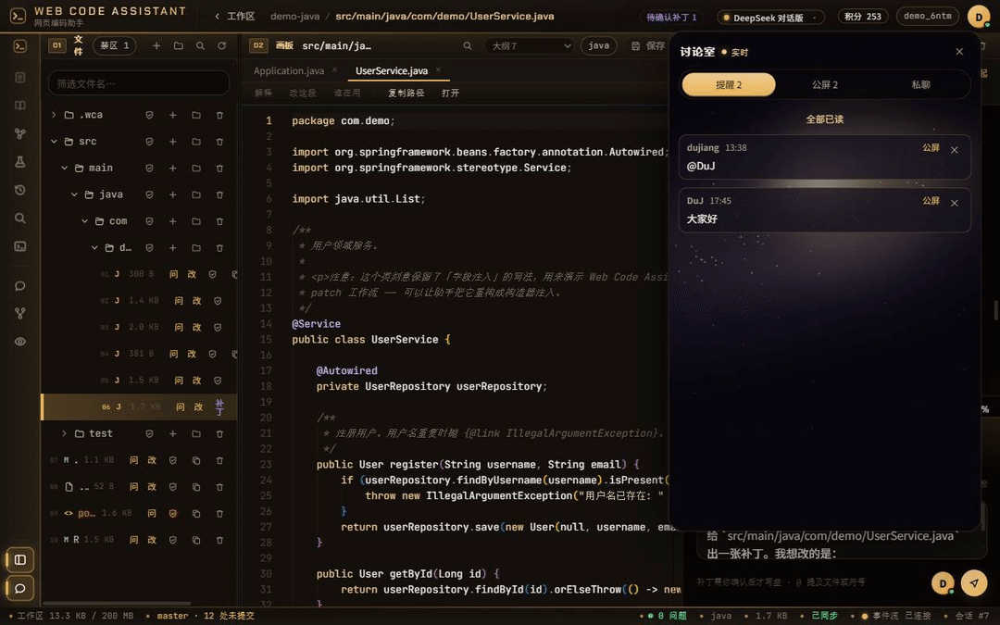

# Web Code Assistant · 网页版编码助手

浏览器里的三栏仓库：**左边真实文件树，中间 Monaco，右边 AI 对话**。

模型会读代码、搜引用、出 unified diff。**它没有写盘权限。** 你在补丁卡上点「应用」，文件才会被改写。

<p align="center">
  <a href="https://gitee.com/du-jiangjiang/web-code-assistant">Gitee</a>
  ·
  <a href="https://github.com/Dujiang777/WebCodeAssistant">GitHub</a>
  ·
  <a href="http://139.199.88.15:8081/">在线演示</a>
</p>

<div align="center">
  
  <p><sub>当前工作台。左边是磁盘上的目录，中间是标签页编辑器，右边是对话和还没写盘的补丁卡。</sub></p>
</div>

---

## 模型会写。你来拍板。

工作区是服务器上的真实目录，不是浏览器里的虚拟盘。补丁在你点应用之前会干跑一遍、算出影响面、在编辑器里从原文一段段放到改后。顶上写着「预览 · 未写盘」。

| 它保证的事 | 不是靠 prompt 劝它 |
| --- | --- |
| 越界的路径读不到 | 三层路径校验，符号链接也走不出工作区 |
| 模型改不了磁盘 | 工具集里没有写文件；唯一写盘入口是你点的「应用」 |
| 没点确认就不会落盘 | `propose_patch` 只出卡。磁盘变了会标「底片已变」，应用按钮灰掉 |
| 花不出去的钱扣不成负数 | 每轮预扣，按 token 多退少补；余额不足返回 402 |

---

## 看产品

按访客会走到的顺序。动图是对着当前界面实拍的，不是设计稿。

### 产品首页

象牙纸面、黄铜点缀。中间这张工作台会把「提问 → 出卡 → 看着改 → 应用」演一遍。点某一步，循环停在那一幕。

<div align="center">
  
</div>

登录与否都先到 `/#/`。进工作区、工作台、模型、积分都开新标签，这一页自己留着。顶栏可切中英、白天 / 夜晚。

### 登录

两栏工作室：左边把人在环上的流程打一遍，右边才是表单。图形验证码、一键演示账号、找回密码、邮箱验证。连续失败 5 次锁 15 分钟。

<div align="center">
  
</div>

### 工作区

内置示例、Git 浅克隆、ZIP 上传。每个工作区是磁盘上的一个目录。卡片上可以打开、改名、删除。改名只改显示名，路径不动。

<div align="center">
  
</div>

### 工作台

文件树上有禁区盾牌、悬停问 / 改、补丁痕迹。编辑器是 Monaco 标签页，Ctrl/⌘+P 快速打开。对话里的 `路径:行号` 能点；补丁卡上有影响面、看着改、应用并验收。右下角是讨论室。底栏能看见 Git 分支和未提交文件。

<div align="center">
  
</div>

### 讨论室

登录用户之间的公屏和私聊。**不写盘、不调模型。** 提醒可一条条关掉；公屏能回复、撤回、编辑、@、带上选中的代码；私聊有输入中和已读。

<div align="center">
  
</div>

### 积分中心

余额、套餐、流水、一键对账。每轮对话先预扣，按真实 token 多退少补。流水里一轮会出现两行，净额才是实际花费。

<div align="center">
  
</div>

---

## 工作台里有什么

都已经在线上，不是路线图。

**补丁闭环**
模型只出 unified diff。卡片上有影响面、PR 预演、看着改。应用前再干跑一次：磁盘已经变了就标「底片已变」。应用后按项目自己的 Maven / Gradle 编译，失败把输出喂回去。测试失败（含测试代码编译不过）也可以一键交给 AI 出最小修复。

**证据**
回答里的 `路径:行号` 是可点的。后端会核文件在不在、行号越没越界；编造的引用标红。

**边界**
`.wca/CONSTITUTION.md` 注入 system prompt 顶部，Agent 改不了。`.wca/PROFILE.md` 是你写给模型的项目说明，接在宪法后面。`.wca/REDZONE` 是写盘硬门：命中的路径在出卡和应用时都会被拒。这三项永远锁死。

**工具轨道**
宪法、项目说明、Spring 组件地图、测试套件、快照回滚、语义检索、网页终端、讨论室、平行宇宙、Agent 工位，以及显隐文件树 / 对话。悬停有中文名和一句「什么时候用它」。

**待确认收件箱**
顶栏列出这个工作区所有会话里还没点的补丁。点一行跳回去，编辑器里回放。

**本地 Git**
底栏看分支、未提交文件、最近提交。点文件打开。按已应用补丁写说明并 `commit`。只落本地，不 push。

**账号**
双令牌（access 2 小时不落库 / refresh 30 天只存哈希）。邮箱验证、改密、登录设备列表（可逐个踢掉）。改密会作废其他设备。

**模型**
平台模型点卡片即默认。自带 Key 走六家预设，密钥 AES-GCM 存库、只回显尾号。「试一句」不走积分。

**同一套 Agent，两种口吻**
交付少说话给结果，教学讲清动机和取舍。不改工具集，不改安全边界。

**停止本轮**
协作式取消：当前工具跑完即停，半截回答保留，预扣全额退回。

---

## 十分钟跑起来

### Docker Compose（推荐）

```bash
cd deploy
cp ../.env.example .env
# 至少改掉：DB_PASSWORD / JWT_SECRET / LLM_*
docker compose up --build
```

打开 **http://localhost:5173**，会落到产品首页。

| 路径 | 页面 |
| --- | --- |
| `/#/` · `/#/home` | 产品首页 |
| `/#/login` | 登录 / 注册 |
| `/#/workspaces` | 工作区列表 |
| `/#/ide/:id` | 三栏工作台 |
| `/#/models` | 模型服务 |
| `/#/credits` | 积分中心 |
| `/#/account` | 账号与安全 |
| `/#/admin` | 管理后台（仅 ADMIN） |

不填模型也能启动：文件浏览和编辑照常用，对话会提示「模型未配置」。完整变量清单在仓库根目录 [`.env.example`](.env.example)，每一行写了为什么要有它。

### 本机跑

前置：JDK 21、Node 20+、MySQL 8.0.13+。

```bash
mysql -h 127.0.0.1 -P 3306 -u root -p \
  -e "create database if not exists webcode character set utf8mb4 collate utf8mb4_0900_ai_ci;"

cd backend
export DB_URL="jdbc:mysql://127.0.0.1:3306/webcode?useUnicode=true&characterEncoding=UTF-8&useSSL=false&allowPublicKeyRetrieval=true&connectionTimeZone=%2B08:00&forceConnectionTimeZoneToSession=true"
export DB_USER=root DB_PASSWORD=你的密码
export JWT_SECRET="dev-only-secret-please-override-with-32-bytes-at-least"
export LLM_BASE_URL="http://127.0.0.1:8787/v1" LLM_API_KEY=mock LLM_MODEL=mock-coder
export ADMIN_USERNAMES=admin MAIL_MODE=dev
./gradlew bootRun

# 另开终端
cd frontend && npm install && npm run dev
```

任何 OpenAI 兼容服务都可以（DeepSeek / 通义 / Kimi / vLLM / Ollama / one-api），三件事：`LLM_BASE_URL`（要带 `/v1`）、`LLM_API_KEY`、`LLM_MODEL`（必须支持 function calling）。密钥只存在后端，不会下发到浏览器。

语义检索要单独配 embedding（DeepSeek 官方没有 `/v1/embeddings`）。`LLM_EMBED_MODEL` 留空 = 检索不可用。

离线自测可以用仓库自带的 mock：

```bash
node tools/mock-llm/server.mjs --port 8787
```

**不要在真实环境里用它冒充模型。**

### 第一次打开，建议这样走

1. 首页看一遍四步循环，再进登录。
2. 注册或演示账号 → 工作区 → **内置示例（最快）**。
3. 打开 `UserService.java`，问「解释一下这个类」。引用 chip 能点。
4. 选中 `@Autowired` 那两行，问「改成构造器注入」。出现紫色补丁卡，磁盘还没动。
5. 看影响面，点「看着改」，再「应用并验收」或只「应用并写盘」。
6. 刷新整页：文件、对话、补丁状态都在。

---

## 设计为什么这样

| 决策 | 原因 |
| --- | --- |
| 模型只能出补丁 | 写盘发生在 `PatchService.apply`。人在环上是代码结构，不是一段提示词 |
| 生成时就干跑 | 用完整文件内容试应用。点「应用」时不会突然冲突；应用前再干跑，磁盘变了就禁用 |
| 禁区是硬门 | `.wca/REDZONE` 在出卡和应用两处拒绝。宪法只作用于 prompt |
| 回写必须整文件读 | 截断后再应用会写出残缺文件 |
| 超过 512 KB 只读 | 否则一次保存等于把大文件截断覆盖 |
| 消息和事件分通道 | `POST /messages` 立刻返回 id；SSE 走 `/events`，断线带 `afterId` 回放 |
| 不用 WebFlux | 虚拟线程够用。Agent 回合是阻塞 IO，代码保持同步 |
| Redis 可降级 | 只做限流和配额。连不上退回进程内，不挡功能 |
| 四个工具 + 两个自查 | `list_dir` / `read_file` / `grep` / `propose_patch`，加上 `run_tests` 与 `spring_map`。没有 `run_command` |
| 编译参数不给模型 | 命令由服务端拼装。模型只能提补丁 |
| PR 预演是派生视图 | 不落库、不改补丁状态，只帮你决定要不要应用 |

工作台是暗房黄铜（默认），另外两套是墨玉翡翠和暖纸墨字。换肤只换色相。产品首页是象牙纸 × 黄铜，变量挂在 `.gate` 上，不动工作台的 `:root`。

---

## 架构

```
浏览器 (React + Vite + Monaco，hash 路由)
  ├── 产品首页 /#/ ：象牙纸 + 黄铜，进产品开新标签
  ├── 工作台 /#/ide/:id ：工具轨道 + 三栏
  ├── 讨论室：全站悬浮框，SSE 独立于对话
  ├── 二级页：工作区 / 模型 / 积分 / 账号 / 管理 / 邮箱验证 / 重置密码
  └── SSE：fetch + ReadableStream（要带动态 Bearer）
        │
        ▼
Spring Boot 3.5 (Java 21, 虚拟线程)
  ├── security/   双令牌、失败锁定、登录审计、防账号枚举
  ├── credit/     账户 / 只增账本 / 套餐 / 订单 / 支付（mock 可替换）
  ├── workspace/  路径、文件、配额、快照、禁区、改名
  ├── scm/        浅克隆、zip、本地 git
  ├── room/       讨论室。不碰磁盘，不走模型
  ├── agent/      编排、工具、补丁、影响面、PR 预演、SSE
  ├── build/      编译 + 测试
  ├── terminal/   网页终端（只给登录用户，模型没有命令工具）
  ├── semantic/   切块 + embedding
  ├── constitution/ 宪法 + 项目说明
  ├── map/        Spring Bean / 端点 / 注入
  ├── context/    system prompt + 引用校验
  └── llm/        目录 + BYOK、流式、限流
        │
        ├── MySQL 8（Flyway V1→V15）
        └── Redis 7（可降级）
```

**一轮对话怎么计费**

```
POST /messages ─► 余额不足 → 402
                 └─► HOLD −30
                       └─► 流式输出
                             └─► SETTLE ±N   按 token 多退少补
                                   └─► 失败则 RELEASE 全额退回
```

---

## 自测

四个脚本，覆盖四层。基线 83 / 65 / 114 / 15，全部 0 失败。对着 **mock 模型**跑；接真实模型会掉十几条，那是模型行为差异，不是代码回归。

```bash
node tools/e2e-smoke.mjs                 # 健康 / 工作区 / 对话 / 补丁 / 宪法 / 地图 / PR 预演 / 测试
node tools/e2e-features-13-16.mjs        # 工位 / 闸门 / What-if / 特性开关
node tools/e2e-auth-credits.mjs          # 账号、令牌轮换、订单幂等、预扣结算
node tools/e2e-multifile-patch.mjs       # 多文件补丁拆卡与 apply-all
```

`e2e-auth-credits.mjs` 依赖 `LLM_EMBED_MODEL`。应用补丁若命中特性开关，请求必须带 `{"acknowledgeFlag": true}`，否则 `409 FLAG_ACK_REQUIRED`。

浏览器自检：`node tools/ui-probe.mjs <steps.json> <log>`。剧本在 `tools/ui-steps/`。

---

## 接口

全部在 `/api` 下。除公开端点外需要 `Authorization: Bearer <accessToken>`。

公开：`/health`、`/auth/register`、`/auth/login`、`/auth/refresh`、`/auth/verify-email`、`/auth/resend-verification`、`/auth/forgot-password`、`/auth/reset-password`。

**账号**

| 方法 | 路径 | 说明 |
| --- | --- | --- |
| `POST` | `/auth/login` | `{ identifier, password }`。失败 5 次锁 15 分钟 |
| `POST` | `/auth/refresh` | 轮换。拿已轮换的旧令牌再来 = 重放，吊销该用户全部会话 |
| `POST` | `/auth/change-password` | 其他设备 refresh 全部作废 |
| `GET` · `DELETE` | `/auth/sessions` · `/auth/sessions/{id}` | 登录设备 / 踢掉 |

**工作区 / 对话 / 补丁**

| 方法 | 路径 | 说明 |
| --- | --- | --- |
| `POST` | `/workspaces` | 克隆、示例或 zip |
| `PUT` | `/workspaces/{id}` | 改名。只改显示名 |
| `GET` | `/workspaces/{id}/pending-patches` | 跨会话待确认收件箱 |
| `GET` · `PUT` | `/workspaces/{id}/files?path=` | 读 / 保存 |
| `POST` | `/chat/sessions/{sid}/messages` | 立刻 202 + messageId |
| `GET` | `/chat/sessions/{sid}/events` | SSE，`?afterId=` 回放 |
| `POST` | `/chat/sessions/{sid}/cancel` | 停止本轮 |
| `POST` | `/patches/{id}/apply` | **唯一写盘入口** |
| `GET` | `/patches/{id}/live-preview` | 逐段预览，不写盘 |
| `GET` | `/patches/{id}/blast-radius` | 影响面 |
| `POST` | `/patches/{id}/compile` | 编译验证 |
| `GET` · `PUT` | `/workspaces/{id}/constitution` · `/profile` · `/redzone` | 宪法 / 项目说明 / 禁区 |
| `GET` | `/workspaces/{id}/git` | 本地 Git 状态 |
| `POST` | `/workspaces/{id}/git/commit` | 只落本地 |

**讨论室**（不碰磁盘，不走模型）

| 方法 | 路径 | 说明 |
| --- | --- | --- |
| `GET` | `/room/messages` · `/room/notices` · `/room/threads` | 历史 / 提醒 / 私聊名单 |
| `POST` | `/room/messages` | 正文 1–1000 字；公屏 @ 最多 8 人；约 400ms 限速 |
| `POST` | `/room/messages/{id}/edit` · `/retract` | 改 / 撤回自己的 |
| `GET` | `/room/events` | SSE（`TEXT_PLAIN`） |

**积分**

| 方法 | 路径 | 说明 |
| --- | --- | --- |
| `GET` | `/credits/summary` · `/credits/ledger` · `/credits/reconcile` | 余额 / 流水 / 对账 |
| `POST` | `/credits/orders` · `.../pay` | 下单；支付走条件更新，重试只到账一次 |

管理端需要 `role=ADMIN`，且每次从数据库重读角色。用户列表有分页和关键词，没有「一页倒出全部」。

SSE 每帧 `data: {json}`，`seq` 在会话内单调递增。`citations` 在 `done` 之前发。`canceled` 之后紧跟 `done`。`seq` 不叫 `id`：补丁事件的 `id` 是补丁 uuid。

---

## 数据与安全

Flyway 自动迁移（V1 → V15）。核心关系：**`credit_ledger` 是事实，`credit_accounts` 只是缓存。** 余额永远能由账本重算。时间列是 `datetime(6)`，写库用 `now(6)`。

| 面 | 做法 |
| --- | --- |
| 路径越界 | 形式校验 → 词法归一化 → 真实路径（含符号链接）仍在工作区内 |
| 越权 | 每个查询带 `userId`，查不到一律 404 |
| 上传 | zip slip / zip bomb / 拒绝符号链接 |
| 克隆 | 只允许 http/https/git/ssh，depth=1 + 超时 |
| 令牌 | access 不落库；refresh 只存 sha256；轮换 + 重放检测 |
| 余额 | `update ... set balance = balance - :a where balance >= :a`，禁止读改写 |
| 支付 | `where status='PENDING'` + 账本唯一键 `recharge:{orderNo}` |
| 管理员 | 每次从数据库重读角色，不信任 token 里带的 |

刷新必须防并发：前端 `refreshAccessToken()` 是单例 Promise。SSE 的令牌每次建连现取。

上线必做：`ADMIN_USERNAMES` 造出第一个管理员后清空、`MAIL_MODE=smtp`、`FRONTEND_BASE_URL` 改成你的域名、`JWT_SECRET` ≥ 32 字节、`CREDIT_ENFORCE=true`。

---

## 已知限制

- 停止是协作式取消，正在生成的模型流不能半途掐断；工具会在下一个边界停。
- 超过 512 KB 的文件只读；改它们靠补丁（上限 8 MB）。
- 多文件应用不是事务：单个失败不阻断整批，应用前有自动快照可回滚。
- 没有 LSP。Monaco 只做语法着色。
- 编译验证不是沙箱，带着服务进程身份跑项目自己的构建。
- 引用校验只查文件和行号在不在，不判断那一行是不是那个方法。
- 支付是模拟的。接微信 / 支付宝要自己补回调验签。
- 计费是产品内用量，不对齐服务商账单。
- 登录锁定按账号计，没有按 IP。

**还没做：** 每用户 Docker 沙箱、Java LSP、真实支付网关、IP 限流、多人同时改同一工作区、自动开 PR。

---

## 目录

```
web-code-assistant/
├── .env.example              环境变量样板（上线必改项标了 ★）
├── backend/                  Spring Boot
│   └── src/main/resources/
│       ├── db/migration/     Flyway V1 → V15
│       └── samples/demo-java/  内置示例（带一个待重构点）
├── frontend/                 React + Vite + Monaco
├── deploy/                   Compose 与云端构建
├── docs/media/               README 用的动图和封面
└── tools/
    ├── mock-llm/             离线自测模型
    ├── e2e-*.mjs             四条接口基线
    └── ui-probe.mjs          浏览器自检
```

---

模型读不到的真的读不到，改不了的真的改不了，你没点的不会落盘。这些边界每一处都能被自检脚本复现。
